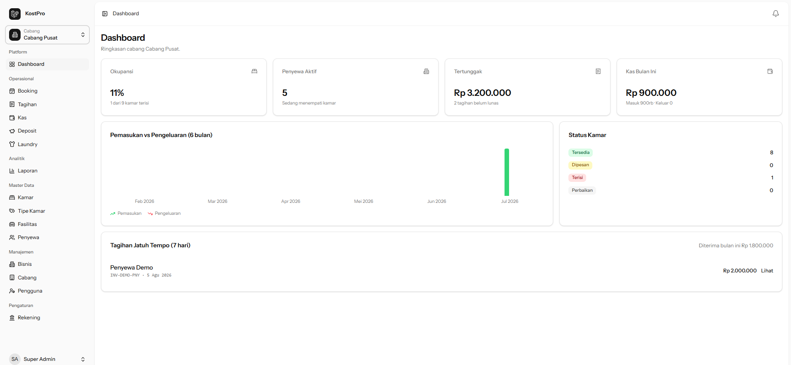
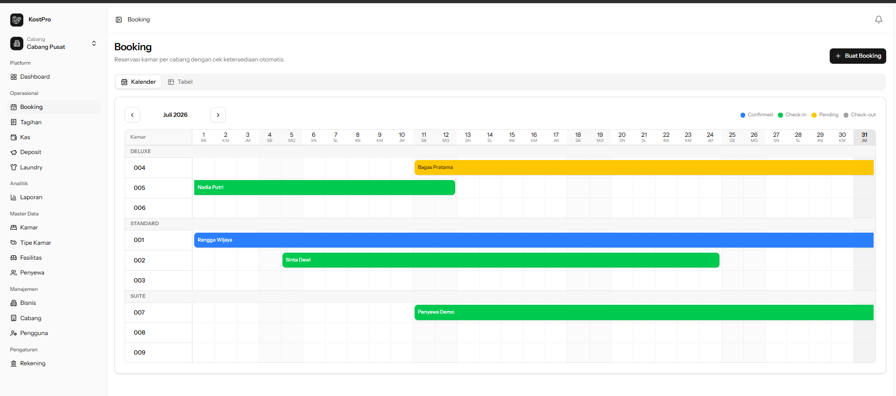
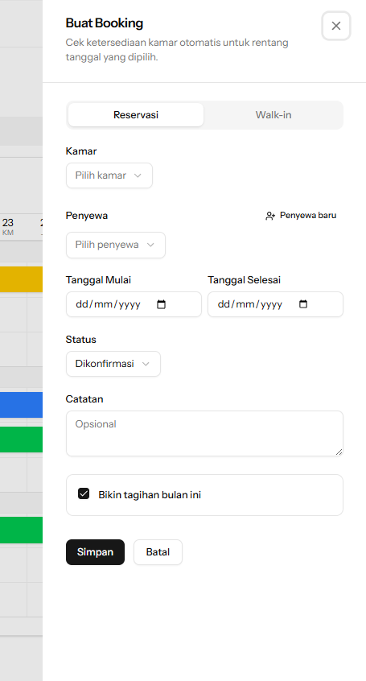
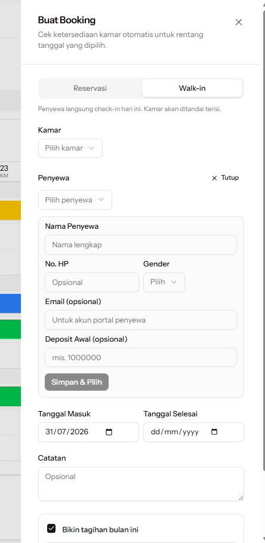
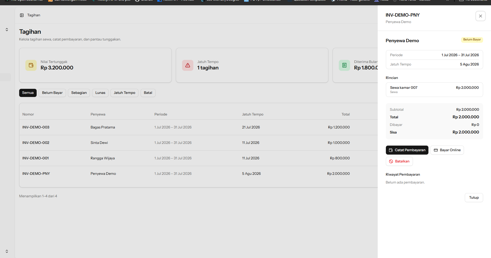
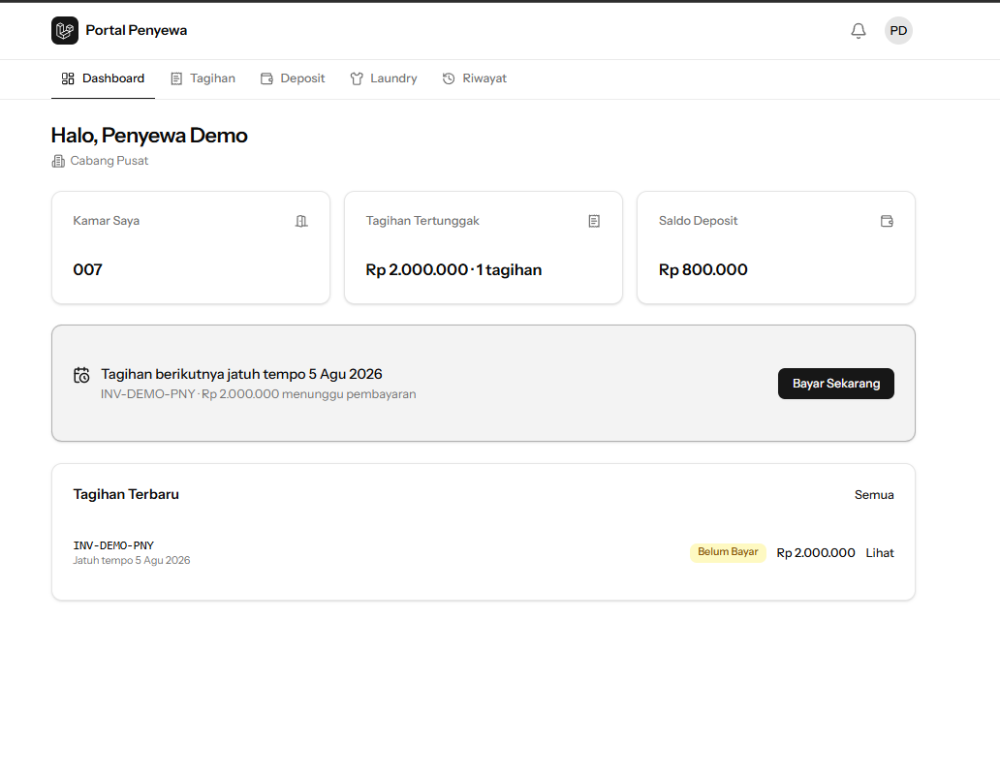

# KostPro

**Aplikasi manajemen kost/rumah kontrakan berbasis web — SaaS multi-bisnis & multi-cabang.**

KostPro membantu pemilik dan pengelola kost menjalankan operasional harian dalam satu tempat: manajemen kamar, penyewa, booking, front desk, tagihan berulang, pembayaran (gateway online & transfer manual), deposit, laundry, arus kas, dan notifikasi jatuh tempo. Penyewa mendapat **portal mandiri** untuk melihat kamar, tagihan, riwayat pembayaran, saldo deposit, dan bayar online/upload bukti transfer.

Satu platform bisa menampung banyak **bisnis (tenant)**, tiap bisnis punya banyak **cabang (branch)**, dan tiap cabang mengisolasi datanya sendiri.

> Dokumen fondasi: [PRD.md](./PRD.md) · [DESIGN.md](./DESIGN.md) · [CHANGELOG.md](./CHANGELOG.md)

---

## Open Source & Dukungan

KostPro **gratis dan open source** ([lisensi MIT](./LICENSE)) — bebas kamu self-host, pelajari, dan kembangkan sendiri.

- 💻 **Self-host** — ikuti panduan [Pengembangan](#pengembangan) di bawah untuk menjalankan sendiri.
- ❤️ **Dukung** — kalau proyek ini membantu, kamu bisa traktir lewat Saweria (tautan di landing page).
- 🛟 **Dibantu pasang** — males ribet install atau butuh hosting? Kami bisa setup-kan. Hubungi kontak di landing page.

---

## Tech Stack

| Lapisan | Teknologi |
|---|---|
| Backend | Laravel 13, PHP 8.4 |
| Frontend | Inertia 2 + React 19 + TypeScript, Vite |
| Styling | Tailwind CSS v4, shadcn/ui, komponen modal `inertiaui/modal` |
| Auth | Laravel Fortify (+ passkeys, 2FA) |
| RBAC | `spatie/laravel-permission` (role & permission global) |
| Media | `spatie/laravel-medialibrary` (KTP, bukti bayar, foto kamar) |
| Audit | `spatie/laravel-activitylog` |
| Monitoring | Laravel Pulse |
| Testing | Pest / PHPUnit |

---

## Fitur Utama

- **Multi-tenant & multi-cabang** — isolasi data per cabang lewat scope query + branch switcher; owner lihat semua cabang, admin/staff dibatasi cabang yang ditugaskan.
- **Master data** — Tipe Kamar, Kamar (status available/booked/occupied/maintenance), Fasilitas, Penyewa (identitas + KTP).
- **Booking & Front Desk** — reservasi date-range dengan engine anti double-booking, kalender timeline per tipe kamar, check-in/out, perpanjang sewa, walk-in.
- **Tagihan (Invoice)** — generate otomatis dari booking, tagihan berulang bulanan, denda telat otomatis, void.
- **Pembayaran** — gateway online **agnostic** (driver Midtrans/Null, ganti cukup ubah config) + **transfer manual** (penyewa upload bukti → staff konfirmasi/tolak, preview thumbnail bukti).
- **Deposit** — saldo ditahan per penyewa dengan ledger potongan/refund.
- **Laundry** — order dibebankan ke deposit atau jadi item tagihan.
- **Arus Kas (Cashflow)** — buku kas per cabang, pemasukan otomatis dari pembayaran lunas, pengeluaran manual terkategori, tampilan kalender.
- **Notifikasi** — reminder jatuh tempo H-7/H-3/H-1 (in-app + email) + notification center.
- **Portal Penyewa** — dashboard, tagihan & bayar, riwayat, deposit, laundry, notifikasi.
- **Dashboard & Laporan** — analitik okupansi/keuangan per cabang + ekspor CSV.

Rincian per fase pengembangan ada di [CHANGELOG.md](./CHANGELOG.md) dan roadmap di [PRD.md](./PRD.md) §8.

---

## Tampilan

<table>
  <tr>
    <td width="50%"><br/><sub><b>Dashboard</b> — ringkasan hunian, tagihan, dan arus kas per cabang.</sub></td>
    <td width="50%"><br/><sub><b>Front Desk & Booking</b> — timeline kamar dengan status check-in/out.</sub></td>
  </tr>
  <tr>
    <td width="50%"><br/><sub><b>Buat Booking</b> — pilih kamar & rentang tanggal, anti double-booking.</sub></td>
    <td width="50%"><br/><sub><b>Buat Booking</b> — konfirmasi penyewa & rincian biaya.</sub></td>
  </tr>
  <tr>
    <td width="50%"><br/><sub><b>Tagihan & Pembayaran</b> — invoice bulanan, QRIS/VA/transfer manual.</sub></td>
    <td width="50%"><br/><sub><b>Portal Penyewa</b> — penyewa lihat tagihan, bayar, & pantau deposit.</sub></td>
  </tr>
</table>

---

## Persyaratan

- PHP **8.4** + ekstensi umum Laravel
- Composer 2
- Node.js 20+ dan npm
- SQLite (default) atau MySQL/PostgreSQL

---

## Setup

### Cara cepat

```bash
git clone <repo-url> kostpro
cd kostpro
composer setup      # install, salin .env, key:generate, migrate, npm install, build
```

`composer setup` menyiapkan semua kecuali data awal. Lanjut isi database demo:

```bash
php artisan db:seed
```

### Cara manual

```bash
composer install
cp .env.example .env
php artisan key:generate

# SQLite (default) — buat file DB-nya
touch database/database.sqlite

php artisan migrate --seed        # skema + role/permission + data demo
php artisan storage:link          # akses media (KTP, bukti bayar) via URL publik

npm install
npm run build
```

---

## Menjalankan

```bash
composer run dev
```

Menjalankan server, queue listener, log tailing (Pail), dan Vite sekaligus. Aplikasi bisa diakses di `http://localhost:8000`.

Kalau mau manual (dua terminal):

```bash
php artisan serve
npm run dev
```

---

## Akun Demo

Semua akun memakai password **`password`** (di-seed oleh `DemoSeeder`).

| Peran | Email | Akses |
|---|---|---|
| Super Admin | `superadmin@kostpro.test` | Seluruh platform, lintas tenant |
| Owner | `owner@kostpro.test` | Semua cabang di tenant-nya, kelola staff & kebijakan |
| Admin Cabang | `admin@kostpro.test` | CRUD operasional di cabang yang ditugaskan |
| Staff / Front Desk | `staff@kostpro.test` | Operasional harian (booking, bayar, laundry) |
| Penyewa | `penyewa@kostpro.test` | Portal penyewa |

---

## Role & Akses

RBAC global via `spatie/laravel-permission`; scope cabang ditegakkan di layer query + otorisasi (bukan sekadar sembunyikan menu). Ringkasan (detail di [PRD.md](./PRD.md) §4):

| Domain | super-admin | owner | admin | staff | penyewa |
|---|:--:|:--:|:--:|:--:|:--:|
| Tenant/Bisnis | CRUD | R (sendiri) | – | – | – |
| Cabang | CRUD | CRUD | R | R | – |
| Staff/User | CRUD | CRUD | R | – | – |
| Operasional (kamar, penyewa, booking, tagihan, kas, deposit, laundry) | – | CRUD | CRUD | terbatas | R (self) |
| Portal | – | – | – | – | ✓ |

- **Super Admin** bypass semua lewat `Gate::before`.
- **Owner** = admin tingkat tenant: otomatis akses semua cabang miliknya.
- **Admin Cabang** & **Staff** dibatasi cabang lewat pivot `branch_user` + branch switcher.

---

## Testing & Kualitas

```bash
php artisan test              # jalankan test suite (Pest)
php artisan test --compact    # output ringkas
composer test                 # lint + types + test (dipakai CI)

vendor/bin/pint               # format PHP (Laravel Pint)
npm run types:check           # cek TypeScript (tsc)
npm run lint:check            # ESLint
npm run build                 # build produksi Vite
```

---

## Konfigurasi Penting (`.env`)

### Pembayaran (gateway online)

| Variabel | Fungsi | Default |
|---|---|---|
| `PAYMENT_GATEWAY` | Driver pembayaran online: `midtrans`, `paywuz`, atau `null` (lokal/test) | `null` |
| `MIDTRANS_SERVER_KEY` / `MIDTRANS_CLIENT_KEY` | Kredensial Midtrans (jika driver `midtrans`) | – |
| `MIDTRANS_IS_PRODUCTION` | `true` = mode produksi, `false` = sandbox | `false` |
| `PAYWUZ_BASE_URL` | Endpoint API Paywuz (jika driver `paywuz`) | – |
| `PAYWUZ_KEY` | API key Paywuz | – |
| `PAYWUZ_WEBHOOK_SECRET` | Secret untuk verifikasi tanda tangan webhook Paywuz | – |

Ganti gateway pembayaran cukup ubah `PAYMENT_GATEWAY` — domain hanya bicara ke kontrak `PaymentGateway`, jadi tidak terkunci ke satu vendor.

### Penagihan & Portal

| Variabel | Fungsi | Default |
|---|---|---|
| `BILLING_INVOICE_LEAD_DAYS` | Jeda (hari) pembuatan tagihan sebelum periode | `7` |
| `BILLING_LATE_FEE_ENABLED` | Aktifkan denda telat otomatis | `false` |
| `BILLING_LATE_FEE_TYPE` | Jenis denda: `percentage` atau `fixed` | `percentage` |
| `BILLING_LATE_FEE_VALUE` | Nilai denda (persen atau nominal, sesuai `_TYPE`) | `0` |
| `PORTAL_DEFAULT_PASSWORD` | Password default akun penyewa baru saat di-provision staff | `kostpro123` |

### Email / SMTP (notifikasi jatuh tempo)

| Variabel | Fungsi | Default |
|---|---|---|
| `MAIL_MAILER` | Driver mail: `smtp`, `log`, dll | `log` |
| `MAIL_HOST` / `MAIL_PORT` | Host & port SMTP | – |
| `MAIL_USERNAME` / `MAIL_PASSWORD` | Kredensial SMTP | – |
| `MAIL_SCHEME` | Enkripsi koneksi (mis. `smtps`/`tls`) | – |
| `MAIL_FROM_ADDRESS` / `MAIL_FROM_NAME` | Alamat & nama pengirim | – |

### Demo

| Variabel | Fungsi | Default |
|---|---|---|
| `KOSTPRO_DEMO` | Tampilkan kredensial akun demo di halaman login. Set `false` di produksi | `true` |

> Konfigurasi lain (`APP_*`, `DB_*`, `SESSION_*`, `QUEUE_*`, `REDIS_*`, `AWS_*`, dll) mengikuti standar Laravel — lihat `.env.example`.

---

## Struktur Singkat

```
app/
├── Actions/            # business logic (Billing, Booking, Deposit, Laundry, ...)
├── Enums/              # UserRole, InvoiceStatus, PaymentStatus, ...
├── Http/Controllers/   # per domain (Master, FrontDesk, Billing, Portal, Settings, ...)
├── Models/             # + Concerns/BelongsToBranch (scope cabang)
└── Support/            # BranchContext (branch aktif per-request)
resources/js/
├── pages/              # halaman Inertia (React)
├── components/         # komponen UI (shadcn + kustom)
├── layouts/            # app (sidebar staf) / portal (header penyewa) / settings
└── routes/             # Wayfinder (route helper ter-generate)
database/
├── migrations/  factories/  seeders/   # RolePermissionSeeder + DemoSeeder
```
